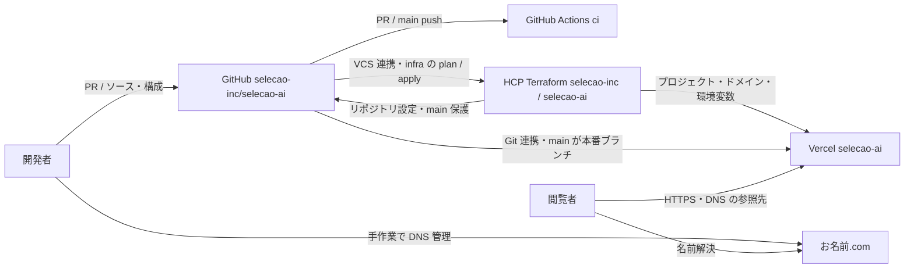

# ARCHITECTURE

M1 の構成。根拠は [AGENTS.md](../AGENTS.md)、[package.json](../package.json)、[Next.js 設定](../next.config.ts)、[infra](../infra/README.md)、[CI](../.github/workflows/ci.yml)。外部サービスの実設定をこの文書作成時に再確認したものではない。

## 構成図

HCP の VCS 連携・Auto-apply は [infra/README.md のセットアップ記録](../infra/README.md#初回セットアップ済みissue-2) に基づく。全 PR での plan の実行条件は未確認。DNS の設定値・確認方法と main の保護条件は [RUNBOOK](RUNBOOK.md) に集約する。

## 各サービスの役割と管理境界

| サービス | 役割 | 定義・記録 |
|---|---|---|
| GitHub | ソース・Issues・PR、Actions による検証。リポジトリ設定と main 保護は Terraform 管理 | `AGENTS.md`、`.github/`、`infra/github.tf` |
| HCP Terraform | `infra/` のリモート実行と state 管理。PR で plan をレビューし、人間の承認後の main マージで反映 | `infra/versions.tf`、`infra/README.md` |
| Vercel | Next.js のビルド・配信、Git 連携。本番ブランチは `main`、`www` は apex へ 308 転送 | `infra/main.tf` |
| お名前.com | `selecao.ai` の DNS を手作業で管理。Web 用と既存メール用のレコードを保持 | `RUNBOOK.md` の DNS 節（Terraform 管理外） |

HCP の認証用環境変数と、サイトへ渡す環境変数は別物。HCP の認証・復号鍵は Sensitive 変数、サイト用の値は `infra/secrets.enc.yaml` に暗号化して保存する。Terraform が復号し、同じ値を Vercel の `production` / `preview` に設定する（`development` は対象外）。キー名は公開可能な前提。復号後の値は state に含まれるため、state の閲覧権限も制限する。

## アプリと技術選定

以下の理由は現行実装・運用ルールとの対応を説明したもの。当初の代替案比較は設計書本文がリポジトリにないため未確認。決定と制約は [DECISIONS](DECISIONS.md) を参照。

| 選定 | 現状と採用理由 |
|---|---|
| Next.js / React / TypeScript | `app/` の App Router に画面・layout・metadata を集約し、Vercel の `nextjs` プロジェクトで配信する。M1 は準備中の `/` のみで、リクエストごとのデータ取得はない。静的生成方針は `AGENTS.md` にあるが、`output: "export"` の設定ではない |
| Tailwind CSS v4 | `app/globals.css` と画面のユーティリティクラスでスタイルを記述。CSS 処理は `next.config.ts` の Turbopack 設定にある |
| pnpm / 固定依存 | `packageManager` と lockfile に基づく frozen install を CI と開発で共用し、意図しない版の差を避ける。Node は `engines.node` を正とする |
| ESLint / TypeScript / Vitest | lint・型・画面テスト・build を同じ `ci` job で検証する。画面テストは `tests/page.test.tsx` |
| Terraform + HCP Terraform | GitHub・Vercel の管理対象を PR の差分と plan でレビューし、state と実行を HCP に集約する |
| SOPS / age | サイト用秘密情報を暗号化したまま Git で管理し、HCP の復号鍵から Vercel へ投入する |

版の正本は `package.json`、`pnpm-lock.yaml`、`infra/versions.tf`、`infra/.terraform.lock.hcl`。数値の一覧は重複管理しない。

## Notion の位置付け

README は設計書・マイルストーンの管理先として Notion を挙げている。Notion CMS を本命とする方針は [ADR-006](DECISIONS.md#adr-006-notion-cms-を本命とする) に記録するが、現時点で SDK・データ取得・再ビルド連携は実装されていない。構成図に CMS の通信経路は含めない。Notion 更新は Issue #7 の別担当作業。
